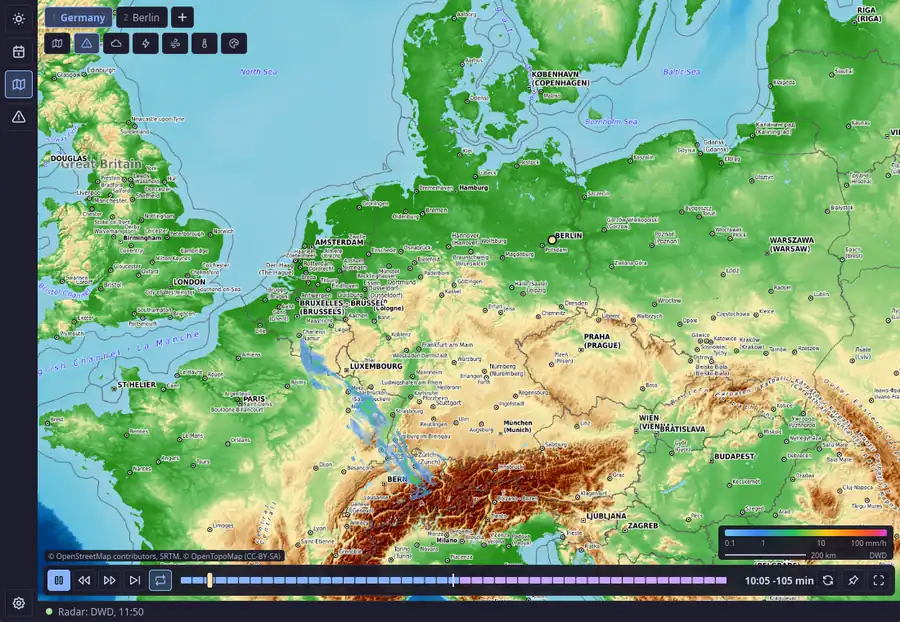
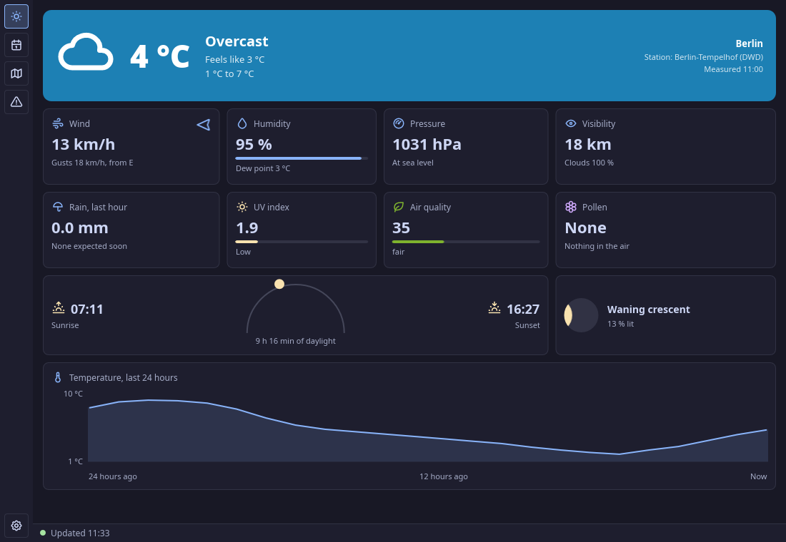
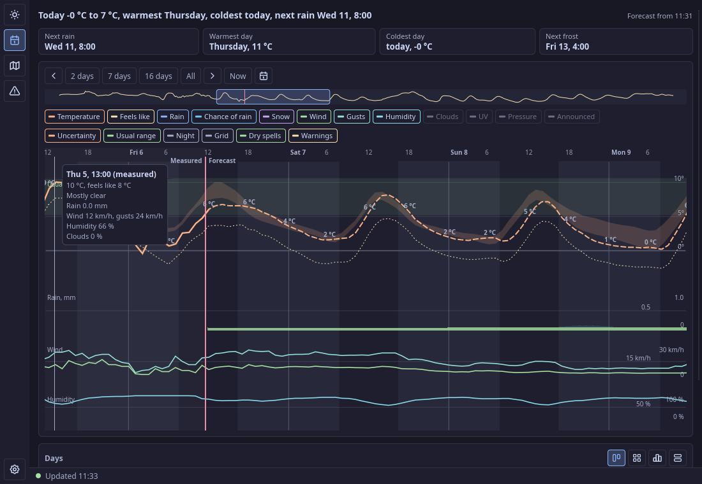
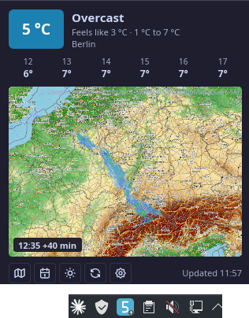

# RustWeather

[](LICENSE)
[](https://github.com/vommie/rustweather/releases)


The temperature in your tray and a weather radar that leaves nothing to wish for. A Rust + Slint rewrite of a PyQt tray
script, for Linux with KDE Plasma.

- **Tray:** the temperature on a tile in its color, with a blue dot when rain is near, a triangle for warnings, a small trend
  arrow, and a pale tile when the data is old. The tooltip says what matters in plain sentences.
- **Radar:** free zoom and pan, the current picture at once, smooth motion, a timeline with past and a two-hour forecast,
  rain arrival at your place, a rain curve, a click on the map for exact values, saved views, warnings and lightning as
  layers, a small always-on-top window.
- **Sources:** DWD through Bright Sky, Open-Meteo, RainViewer outside Germany, a wetterdienst.de station page as a fallback.
- **Maps:** satellite, topographic, OpenStreetMap and more, picked with a preview right on the radar. CARTO needs your key; the standard
  map needs neither key nor network.



| | |
| --- | --- |
|  |  |



## Quick start

1. Install the package (see [Install](#install)) and start RustWeather from the application menu; the temperature appears in the tray.
2. Click the tray icon for the window: current weather, forecast, radar and warnings.
3. Set your place in Settings > Places; a new installation starts with Berlin.

## Build

```bash
cargo build --release
```

## Install

Packages for Arch Linux and Manjaro are on the [releases page](https://github.com/vommie/rustweather/releases).

```bash
curl -LO https://github.com/vommie/rustweather/releases/latest/download/rustweather-x86_64.pkg.tar.zst
sudo pacman -U rustweather-x86_64.pkg.tar.zst
```

## Build the Arch package

```bash
./build-package.sh
```

This writes `dist/rustweather-<version>-1-x86_64.pkg.tar.zst`; install it with `sudo pacman -U`.

## Desktop integration

Settings > Desktop shows the state and installs the application menu entry and the icons for your user, in `~/.local/share`. It
notices a moved program and offers a repair. Uninstall removes them and the autostart, and leaves your settings and keys alone. Without
the window:

```bash
rustweather --desktop install
```

## API keys

CARTO maps need a key: Settings > Sources.

## Files

Settings in `~/.config/rustweather`, cache in `~/.cache/rustweather`, logs in `~/.local/state/rustweather/logs`.

## Limitations

- Linux with KDE Plasma (Arch Linux, Manjaro); other desktops are not tested.
- The radar and the warnings of the DWD cover Germany; outside, RainViewer and Open-Meteo stand in.

## Contributing

Bug reports and ideas are welcome as [issues](https://github.com/vommie/rustweather/issues) and in the
[discussions](https://github.com/vommie/rustweather/discussions). The repository does not take pull requests.
[AGENTS.md](AGENTS.md) holds the rules for contributors and coding agents.

## Security

Please report security problems privately, as described in [SECURITY.md](SECURITY.md).

## License

MIT. Map borders: Natural Earth (public domain). Icons and tray digits: Tabler Icons (MIT). See `assets/README.md`.

The maps in the screenshots: © OpenStreetMap contributors, SRTM, © [OpenTopoMap](https://opentopomap.org) (CC BY-SA 3.0), Esri and its data partners (satellite, terrain, relief, dark gray); the screenshots are therefore under CC BY-SA 3.0 as well. Radar, warnings and weather data in them: Deutscher Wetterdienst (through Bright Sky), Open-Meteo, EUMETSAT (clouds).
